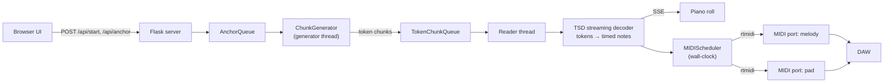

# AnchorFlow — Real-time Ambient Machine

<p>
  
  
  
</p>

**AnchorFlow** turns a theme-conditioned Transformer into an endless, steerable ambient music machine.
It generates two-track (MELODY + PAD) MIDI **continuously and in real time**, shows it on a live piano roll in the browser, and sends it to your DAW through virtual MIDI ports.

While it plays, you can drop in **anchors** (short MIDI motifs or chords). The music shifts to follow the new anchor without stopping the stream.

The generator is based on [Theme Transformer](https://github.com/atosystem/ThemeTransformer) (Shih et al., IEEE TMM 2022). This repository adds the streaming engine, the real-time scheduling layer, and the web interface.

---

## Features

- **Endless generation**: autoregressive token generation runs in a background thread and keeps a few seconds ahead of playback.
- **Seed & anchor control**: start from a seed MIDI, then inject anchors at any time to change the theme the model is conditioned on.
- **Theme recurrence**: the current theme is re-introduced periodically, either decided by the model (`auto`) or on a fixed interval, so the piece stays grounded instead of drifting.
- **Dual-port MIDI output**: MELODY and PAD go to separate virtual ports, so each can drive its own instrument in a DAW.
- **Live piano roll**: browser visualization over Server-Sent Events, kept in sync with the actual MIDI output.
- **Real-time guarantees**:
  - grammar-constrained decoding via logit masking (one forward pass always yields one valid token);
  - an enforced minimum time-shift so musical time always advances faster than wall-clock time;
  - a cached encoder memory, so the encoder only re-runs when the theme changes.
- **Safe shutdown**: a Panic button and exit handlers send *All Sound Off / All Notes Off* on all channels.

## How it works



1. **Tokenization**: music is represented as TSD tokens (`Note-On`, `Note-Duration`, `Note-Velocity`, `Time-Shift`) at 40 ms resolution, with program 0 = MELODY and program 88 = PAD.
2. **Generation**: `ChunkGenerator` samples tokens with temperature + nucleus (top-p) sampling. The decoder is conditioned on the current theme through cross-attention.
3. **Anchors**: an anchor replaces the encoder theme and resets the decoder context to the anchor, so later generation develops from the new material.
4. **Playback**: decoded notes are scheduled against a wall clock and sent to the MIDI ports. Playback starts only after a short prebuffer, and the server and browser clocks share the same epoch so the piano roll matches what you hear.

For the full design (threading, GIL considerations, clock sync, throughput model), see [`docs/STREAMING_ARCHITECTURE.md`](docs/STREAMING_ARCHITECTURE.md) (Korean).

## Getting started

### Requirements

- Python 3.9+
- PyTorch 2.x (a CUDA GPU is recommended for real-time performance; the device is picked automatically)
- A virtual MIDI port driver, e.g. [loopMIDI](https://www.tobias-erichsen.de/software/loopmidi.html) on Windows or the IAC Driver on macOS
- A DAW with instrument tracks (tested with Cakewalk)

### Installation

```bash
git clone https://github.com/olavvn/AnchorFlow-realtime-ambient-machine.git
cd AnchorFlow-realtime-ambient-machine

python -m venv venv
# Windows: venv\Scripts\activate   |   macOS/Linux: source venv/bin/activate
pip install -r requirements.txt
```

The pretrained checkpoint `trained_model/model_ep325.pt` is included in the repository.

### MIDI setup

1. Create two virtual MIDI ports, for example `melody` and `pad`, in loopMIDI (or your OS equivalent).
2. In your DAW, enable both ports as MIDI inputs.
3. Route each port to an **instrument track** with a virtual instrument loaded. A plain MIDI track with no instrument will stay silent.

## Usage

### Web app (recommended)

```bash
python webapp/server.py \
    --model-path trained_model/model_ep325.pt \
    --melody-port "melody" \
    --pad-port "pad"
```

Then open **http://127.0.0.1:5000**:

1. Pick a **seed** and press **Start**.
2. Tune the parameters if you like (see below).
3. Click an **anchor** at any time to steer the music.
4. Press **Stop**, or **Panic** if notes keep hanging.

Port names are matched by substring. If the ports can't be opened, the server prints the available ports and keeps running with only the piano roll.

| Option | Default | Description |
|---|---|---|
| `--model-path` | `trained_model/model_ep325.pt` | Model checkpoint |
| `--melody-port` / `--pad-port` | `melody` / `pad` | Output port names (substring match) |
| `--host` / `--port` | `127.0.0.1` / `5000` | Web server address |
| `--device` | auto | `cuda` or `cpu` |
| `--pitch-min` / `--pitch-max` | `0` / `127` | Default generation pitch range |

### CLI (no web UI)

A simpler path that streams straight to MIDI ports:

```bash
# list MIDI output ports
python main_streaming.py --list-ports

# stream
python main_streaming.py --theme path/to/theme.mid --melody-port "melody" --pad-port "pad" --cuda
```

While it's running, type `a <path-to-anchor.mid>` to inject an anchor, or `q` to quit. Run `python main_streaming.py -h` for all options.

## Tuning parameters

These can be set from the web UI sliders or in the `/api/start` request body.

| Parameter | Default | Effect |
|---|---|---|
| `temperature` | 1.0 | Higher means more variety but more drift |
| `top_p` | 0.9 | Nucleus sampling threshold |
| `time_scale` | 1.0 | Scales time-shifts and durations. Lower is denser but has less real-time headroom |
| `min_force_shift` ("min gap") | 12 | Minimum time-shift in steps; **the main knob for keeping up with real time** |
| `theme_recur_mode` | `auto` | `auto` (the model decides), `interval` (fixed period), or `off` |
| `theme_recur_sec` | 16 | Recurrence interval in seconds (`interval` mode only) |
| `pitch_min` / `pitch_max` | 0 / 127 | Allowed pitch range |
| `lead_cap` | 5 | Maximum seconds generation may run ahead of playback |
| `prebuffer` | 4 | Seconds generated before playback starts |

> **Tip:** real-time headroom depends roughly on `time_scale × min_force_shift`. If you lower `time_scale`, raise `min_force_shift`. If the console shows `<<< PAST (pile-up!)`, generation is falling behind playback.

## Adding your own seeds and anchors

Drop `.mid` files into:

- `webapp/assets/seeds/`: starting material
- `webapp/assets/anchors/`: material to inject mid-stream

Files should use **program 0 for melody** and **program 88 for pad** so the tokenizer can tell the tracks apart. Short phrases or chord voicings work best as anchors.

## Project structure

```
.
├── main_streaming.py          # CLI streaming entry point
├── mymodel.py                 # Theme Transformer (encoder–decoder LM) + streaming encode/decode helpers
├── myTransformer.py           # Transformer layers with label-gated cross-attention
├── preprocess/
│   └── vocab.py               # TSD vocabulary, MIDI ⇄ token conversion
├── src/streaming/
│   ├── chunk_gen.py           # ChunkGenerator: constrained autoregressive generation
│   ├── buffer.py              # AnchorQueue, TokenChunkQueue
│   ├── engine.py              # ThemeStreamEngine (CLI path)
│   └── midi_out.py            # MIDI output engine (CLI path)
├── webapp/
│   ├── server.py              # Flask server, streaming decoder, MIDI scheduler, sessions
│   ├── static/                # index.html, app.js (piano roll), style.css
│   └── assets/                # seeds/ and anchors/ MIDI files
├── trained_model/
│   └── model_ep325.pt         # pretrained checkpoint
├── docs/
│   └── STREAMING_ARCHITECTURE.md
└── requirements.txt
```

## Acknowledgements

This project builds on **Theme Transformer** by Yi-Jen Shih, Shih-Lun Wu, Frank Zalkow, Meinard Müller and Yi-Hsuan Yang ([code](https://github.com/atosystem/ThemeTransformer) · [paper](https://arxiv.org/abs/2111.04093)). If you use the model in research, please cite the original paper:

```bibtex
@article{shih2022theme,
  title={Theme Transformer: Symbolic Music Generation with Theme-Conditioned Transformer},
  author={Yi-Jen Shih and Shih-Lun Wu and Frank Zalkow and Meinard M{\"u}ller and Yi-Hsuan Yang},
  journal={IEEE Transactions on Multimedia},
  year={2022},
  publisher={IEEE}
}
```

## License

Released under the [MIT License](LICENSE).